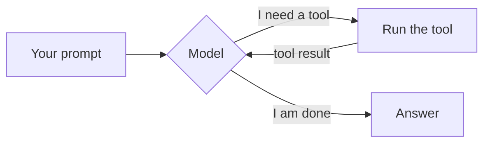

# Strands Agents SDK — from basics to production

A hands-on course for the [Strands Agents SDK](https://strandsagents.com) (Python, `strands-agents` 1.65).
It follows the 14 official Strands lessons, adds the production topics the official course only
mentions (limits, retries, safety, tracing, testing, deployment), and ends with one
production-ready agent that uses everything.

Every lesson has:

- a **README** in simple words: what it is, why you need it, and **every setting explained** in a table
  (what it does, default, what to use in production);
- small **runnable scripts**;
- **offline tests** that run without any API key.

> Strands is AWS's open-source agent SDK, like CrewAI or LangGraph. Its idea is **"let the model drive"**:
> you give the model tools and boundaries, and it decides the steps. You do not draw a flowchart for every task.

## The one idea you need first



A model on its own forgets everything and cannot act. An **agent** wraps the model in a **harness**: the loop
above, plus tools, memory, limits, safety checks, and tracing. **Agent = model + harness.**
This course is about building a good harness.

## Course map

| # | Lesson | You learn | Level | Official lesson |
|---|--------|-----------|-------|-----------------|
| 01 | [The agent loop](lessons/01_agent_loop) | `Agent`, the loop, `AgentResult`, stop reasons, `agent.messages` | Basic | [1](https://strandsagents.com/docs/learning/how-agents-really-work/) |
| 02 | [Model providers](lessons/02_model_providers) | Bedrock, OpenAI, Anthropic, Ollama, every model setting, caching, fallback routing | Basic | [2](https://strandsagents.com/docs/learning/switching-model-providers/) |
| 03 | [Custom tools](lessons/03_custom_tools) | `@tool`, schemas, `ToolContext`, errors, async tools, executors | Basic | 1, 3 |
| 04 | [MCP tools](lessons/04_mcp_tools) | Build an MCP server, connect with `MCPClient`, prefixes, filters | Basic | [3](https://strandsagents.com/docs/learning/give-your-agent-tools-using-mcp/) |
| 05 | [Structured output](lessons/05_structured_output) | Pydantic results, validation retries, fallbacks | Basic | – |
| 06 | [Streaming & callbacks](lessons/06_streaming_callbacks) | Callback handlers, `stream_async`, a streaming API | Basic | [4](https://strandsagents.com/docs/learning/adding-callbacks-and-response-streaming/) |
| 07 | [Hooks & interrupts](lessons/07_hooks_interrupts) | Lifecycle events, audit logs, tool limits, human approval | Intermediate | [5](https://strandsagents.com/docs/learning/control-your-agent-with-hooks/) |
| 08 | [Plugins & skills](lessons/08_plugins_skills) | `AgentSkills`, `GoalLoop`, writing your own plugin | Intermediate | [6](https://strandsagents.com/docs/learning/agent-plugins-and-skills/) |
| 09 | [Steering & interventions](lessons/09_steering_interventions) | Proceed / Guide / Deny / Confirm / Transform | Intermediate | [7](https://strandsagents.com/docs/learning/improve-agent-reliability-with-strands-steering/) |
| 10 | [Context management](lessons/10_context_management) | `context_manager="auto"`, offload strategies, context injection | Intermediate | [8](https://strandsagents.com/docs/learning/context-engineering-and-conversation-management/) |
| 11 | [State, sessions & memory](lessons/11_state_sessions_memory) | Three kinds of state, session managers, long-term memory | Intermediate | [9](https://strandsagents.com/docs/learning/persistent-memory-with-session-managers/) |
| 12 | [Agents as tools](lessons/12_agents_as_tools) | Orchestrator + specialists | Advanced | [10](https://strandsagents.com/docs/learning/multi-agent-patterns-agents-as-tools/) |
| 13 | [Graph workflows](lessons/13_graph_workflows) | Fixed pipelines, fan-out / fan-in, conditions | Advanced | [11](https://strandsagents.com/docs/learning/multi-agent-patterns-graph-workflows/) |
| 14 | [Swarms](lessons/14_swarms) | Agents handing off to each other, safety limits | Advanced | [12](https://strandsagents.com/docs/learning/multi-agent-patterns-agent-swarms/) |
| 15 | [Lifecycle controls](lessons/15_lifecycle_controls) | Turn/token limits, cancel, deadlines, retries, concurrency | Production | – |
| 16 | [Safety & security](lessons/16_safety_security) | Guardrails, PII redaction, untrusted input, least privilege | Production | – |
| 17 | [Observability](lessons/17_observability) | OpenTelemetry traces, metrics, JSON logs | Production | – |
| 18 | [Evals & testing](lessons/18_evals_testing) | Offline unit tests, Strands Evals, chaos, red teaming | Production | [13](https://strandsagents.com/docs/learning/evaluating-agents/) |
| 19 | [Deployment](lessons/19_deployment) | FastAPI + Docker, AgentCore Runtime, Lambda | Production | [14](https://strandsagents.com/docs/learning/deploying-agents-to-the-cloud/) |
| ★ | [Capstone: production support agent](capstone) | Everything above in one service | Production | – |

Two reference pages you will come back to:

- [docs/settings-reference.md](docs/settings-reference.md) — every `Agent(...)` and per-call setting in one place.
- [docs/production-checklist.md](docs/production-checklist.md) — what to check before real users touch your agent.

## Setup (5 minutes)

You need Python 3.13 and [uv](https://docs.astral.sh/uv/).

```bash
uv sync
```

```bash
cp .env.example .env
```

Then pick a model in `.env`:

| You have | Set in `.env` |
|----------|---------------|
| Nothing yet (just looking) | `MODEL_PROVIDER=fake` — offline scripted model, free |
| AWS account with Bedrock access | `MODEL_PROVIDER=bedrock` and optionally `MODEL_ID=` |
| OpenAI key | `MODEL_PROVIDER=openai`, `MODEL_ID=gpt-4o`, `OPENAI_API_KEY=...` |
| Anthropic key | `MODEL_PROVIDER=anthropic`, `MODEL_ID=...`, `ANTHROPIC_API_KEY=...` |
| A laptop (free, local) | `MODEL_PROVIDER=ollama`, `MODEL_ID=qwen3:8b`, then `ollama serve` and `ollama pull qwen3:8b` |

Run any lesson from the repo root:

```bash
uv run python lessons/01_agent_loop/simple_agent.py
```

Run all offline tests (85 tests, no key, no cost, about 6 seconds):

```bash
uv run pytest
```

### How to study one lesson

1. Read the lesson's README (the "In simple words" part first).
2. Run its scripts with `MODEL_PROVIDER=fake` to see the flow, then with a real model.
3. Read its test in `tests/` — it shows the exact behaviour with no randomness.
4. Do the "Try it" exercises at the bottom of the README.

### Troubleshooting

| Problem | Fix |
|---------|-----|
| Imports hang or `ModuleNotFoundError: course_common` on macOS, with the repo inside `~/Documents` or `~/Desktop` | iCloud Drive is syncing `.venv` (thousands of files) and marks them hidden; Python 3.13 skips hidden `.pth` files and blocks on files being uploaded. Keep the venv out of iCloud: `rm -rf .venv && uv venv .venv.nosync && ln -s .venv.nosync .venv && uv sync` (folders ending in `.nosync` are not synced). This repo is already set up that way. |
| `NoCredentialsError` / `AccessDeniedException` | Bedrock needs AWS credentials (`aws sso login`) and model access enabled in the Bedrock console for your region. |
| Ollama answers but never calls tools | Use a tool-calling model (`qwen3`, `llama3.1+`) and raise `num_ctx` (lesson 02). |
| `ValueError: context_manager cannot be used with a RepositorySessionManager` | Use `SnapshotSessionManager` (lesson 11). |

## How the code is organised

```
course_common/      shared settings, model factory, offline ScriptedModel, demo shop tools, logging
lessons/NN_topic/   README.md + runnable scripts for one topic
capstone/           the production agent (package, API, AgentCore entrypoint, Dockerfile, lock file)
tests/              offline tests for every lesson and the capstone
docs/               settings reference and production checklist
```

`course_common` and `capstone` are small local packages. `uv sync` installs them as normal copies (not
editable links) and rebuilds them automatically when you change their files.

Two patterns are used everywhere, because production code needs them:

1. **Agent factory.** Each script has `build_agent(model=None)`. The real model comes from `.env`;
   a test passes a `ScriptedModel`. Same agent, no API calls in tests.
2. **Settings from the environment.** `course_common/config.py` reads `.env`. Code never hard-codes
   a model, region, or key.

## The Strands family (what the menu on strandsagents.com means)

| Name | What it is, simply |
|------|--------------------|
| **Strands Harness SDK** (`strands-agents`) | The toolkit this course teaches: agent loop, tools, hooks, memory, multi-agent. You assemble your own agent. |
| **Strands harness** (`strands-harness`) | A ready-made agent built with the SDK (shell, files, web, memory, tuned prompt). `create_harness()` and go. Good when you want a general assistant fast. |
| **Box** | A sandbox that runs an agent with OS isolation plus a policy that decides which commands and network calls are allowed. |
| **Shell** | A virtual shell made for agents, so "run a command" cannot touch your real machine. |
| **Evals** (`strands-agents-evals`) | Testing for agents: LLM judges, trajectory checks, simulated users, chaos and red-team tests (lesson 18). |
| **Decider** | A small, fast model for yes/no and pick-one decisions inside agents (cheaper than a big model). |
| **Labs** | Experiments that may become features later. |

## Links

- Docs: https://strandsagents.com/docs/
- Python API reference: https://strandsagents.com/docs/api/python/
- Official samples for the video course: `samples/` in the Strands docs repo, linked from each lesson page.
