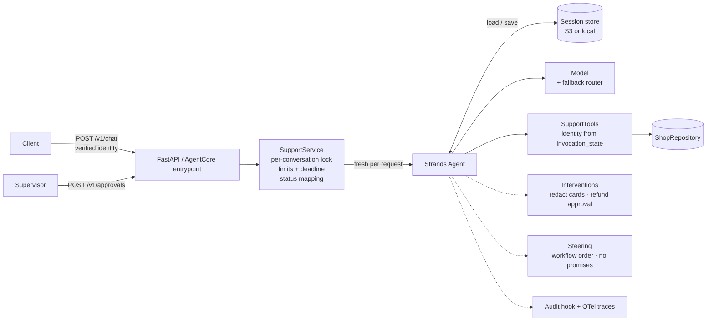

# Capstone — a production customer-support agent

Everything from the 19 lessons in one service: a support agent that answers order questions and
processes refunds, with the controls you need before real customers use it.



## Run it

```bash
uv sync                                        # from the repo root
uv run pytest tests/test_capstone.py           # 13 offline tests
SUPPORT_MODEL_PROVIDER=bedrock uv run uvicorn support_agent.api:build_app --factory --port 8000
```

```bash
curl -s localhost:8000/v1/chat -H 'content-type: application/json' \
  -H 'X-User-Id: user-asha' -H 'X-Customer-Id: C-1001' \
  -d '{"conversation_id": "conv-0001", "message": "My headphones broke. Can I get a refund?"}'
```

Demo data: customer `C-1001` (Asha) has `ORD-5521` headphones $79.99 (delivered), `ORD-5530` hub (shipped),
`ORD-5544` case $19.99 (delivered). `C-1002` (Ben) has a $349 monitor and $899 speakers.

## What each file does (and which lesson it comes from)

| File | Responsibility | Lessons |
|------|----------------|---------|
| [support_agent/config.py](support_agent/config.py) | Every setting, typed, from `SUPPORT_*` env vars | 02, 15 |
| [support_agent/models.py](support_agent/models.py) | Bedrock/OpenAI/Ollama with timeouts, small retries, prompt caching, guardrail, optional fallback `ModelRouter` | 02, 16 |
| [support_agent/data.py](support_agent/data.py) | `ShopRepository` interface + in-memory demo; idempotent refunds | 03 |
| [support_agent/tools.py](support_agent/tools.py) | Tools with **no customer ID argument**: identity from `invocation_state`; ownership/status/amount checks; small results | 03, 16 |
| [support_agent/policies.py](support_agent/policies.py) | `RedactPayments`, `RefundApproval` (Deny > $500, supervisor Confirm > $50), `RefundWorkflow`, `NoTimelinePromises` | 09, 16 |
| [support_agent/skills/](support_agent/skills) | `refund-requests`, `order-questions` loaded on demand | 08 |
| [support_agent/observability.py](support_agent/observability.py) | JSON logs, audit hook (IDs only), OTLP tracing when configured | 07, 17 |
| [support_agent/agent_factory.py](support_agent/agent_factory.py) | **The one place every agent setting is chosen** | all |
| [support_agent/service.py](support_agent/service.py) | Per-request agent, per-conversation lock, limits, deadline, approvals, status mapping, safe errors | 11, 15 |
| [support_agent/api.py](support_agent/api.py) | FastAPI: `/v1/chat`, `/v1/approvals`, `/healthz` | 06, 19 |
| [support_agent/agentcore_main.py](support_agent/agentcore_main.py) | Same service on AgentCore Runtime | 19 |
| [Dockerfile](Dockerfile) + [requirements.lock](requirements.lock) | Hash-locked, non-root, arm64-ready image | 19 |

## The production decisions, explained

| Decision | Why |
|----------|-----|
| **Fresh agent per request**, history from the session store | No shared state between users; any server can handle any request; no `ConcurrencyException`. |
| **Session ID = authenticated user ID + conversation ID** | A user can't open someone else's conversation by guessing its ID (test: `test_conversations_are_private_per_user`). |
| **Per-conversation lock** → status `busy` | Two messages in one conversation at once would race on the same history. (Several servers? Use a distributed lock or session affinity, e.g. AgentCore's per-session microVM.) |
| **Identity in `invocation_state`, not tool arguments** | The model cannot ask for another customer's orders (test: `test_customer_cannot_touch_another_customers_order`). |
| **Rules in code, four layers deep** | Prompt asks → skill guides → steering/interventions enforce → the tool re-checks. |
| **Supervisor approval with interrupts** | Refunds over $50 pause; the run is saved in the session and resumed by a later `/v1/approvals` request (test: `test_large_refund_waits_for_supervisor_then_resumes`). |
| **Workflow check reads saved history** | Steering's `LedgerProvider` is in memory only; a resumed agent would see an empty ledger and block the approved refund. Reading `agent.messages` works after a restart. |
| **Limits + deadline on every run** | `max_turns`, `max_total_tokens`, `deadline_seconds`; mapped to `budget_exceeded` / `cancelled`. |
| **Small set of statuses** | `completed`, `needs_approval`, `budget_exceeded`, `cancelled`, `blocked`, `busy`, `error`. Clients don't parse stop reasons. |
| **Safe errors** | Exceptions are logged with request/session IDs; the client gets a generic message. |
| **Card numbers redacted before the model** | The provider, traces and stored history never see them (test: `test_card_numbers_never_reach_the_model`). |
| **`SequentialToolExecutor`** | Side effects (refund) happen in the order the model chose. |
| **`context_manager="auto"`** + snapshot sessions | Long conversations stay inside the window and cheap. |
| **Retries: 3 model attempts, 3 botocore attempts** | Recover from blips without multiplying into minute-long hangs. |
| **Audit hook logs IDs, status, duration** | Useful for incidents without leaking personal data. |

## Settings (`SUPPORT_*`)

| Variable | Default | Meaning |
|----------|---------|---------|
| `MODEL_PROVIDER` / `MODEL_ID` / `FALLBACK_MODEL_ID` | `bedrock` / `us.amazon.nova-pro-v1:0` / – | model and backup |
| `AWS_REGION`, `TEMPERATURE`, `MAX_TOKENS` | `us-east-1`, `0.2`, `2048` | model call settings |
| `GUARDRAIL_ID`, `GUARDRAIL_VERSION` | – | Bedrock guardrail (enforce mode) |
| `REFUND_AUTO_APPROVE_LIMIT`, `REFUND_HARD_LIMIT` | `50`, `500` | approval thresholds |
| `MAX_TURNS`, `MAX_TOTAL_TOKENS`, `DEADLINE_SECONDS` | `8`, `40000`, `60` | per-request budgets |
| `SESSION_BUCKET`, `SESSION_PREFIX`, `SESSION_DIR` | –, `support-sessions/`, `./sessions` | where conversations are saved |
| `JSON_LOGS`, `LOG_LEVEL` | `true`, `INFO` | logging |

## Before going live (what this demo leaves to you)

- [ ] Replace the demo identity headers with **JWT verification** (Cognito/Okta/AgentCore Identity) in `api.get_caller`.
- [ ] Implement `ShopRepository` over your real order system; make `create_refund` idempotent there too.
- [ ] Set `SUPPORT_SESSION_BUCKET` (S3, encrypted, lifecycle rule for retention) or use AgentCore Memory.
- [ ] A distributed per-conversation lock if you run several replicas without session affinity.
- [ ] Guardrail in shadow mode, then enforce (lesson 16); red-team and chaos tests in CI (lesson 18).
- [ ] An eval suite with real conversations gating each release (lesson 18).
- [ ] Rate limits per user at the gateway; budget alarms on model spend.
- [ ] Dashboards on status counts, tokens per request, tool errors, latency (lesson 17).
