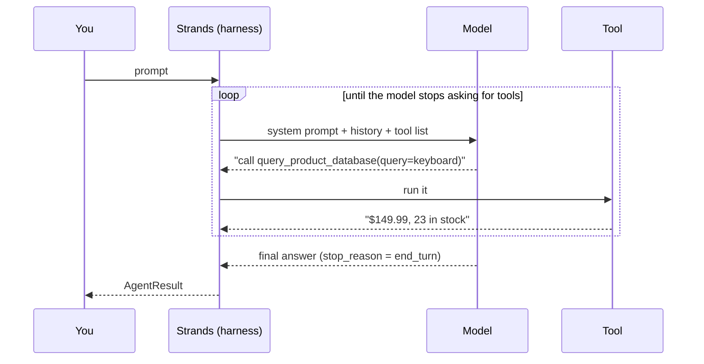

# Lesson 01 — How agents really work

## In simple words

A model (LLM) is like a very smart person with **no memory and no hands**. You send text, it sends
text back, and it forgets everything. It cannot look up today's price or save a file.

An **agent** gives the model hands (tools), a memory (the message history) and a **loop**:



**Agent = model + harness.** The harness is everything around the model: the loop, running tools,
memory, limits, safety checks, logs. Strands is a toolkit for building that harness.

Three kinds of "engineering" you will do in this course:

| Layer | Question it answers | Lessons |
|-------|--------------------|---------|
| Prompt engineering | What do I tell the model? | everywhere |
| Context engineering | What information is in the model's window, and when? | 08, 10, 11 |
| Harness engineering | What runs around the model (tools, limits, hooks, retries)? | 03–19 |

Strands' philosophy: **let the model drive.** You define the tools and the boundaries; the model
decides the steps.

## Files

| File | What it shows |
|------|---------------|
| [loop_by_hand.py](loop_by_hand.py) | The loop in 40 lines of plain Python, no SDK. Read this first. |
| [simple_agent.py](simple_agent.py) | Smallest real Strands agent (no tools). |
| [agent_with_tools.py](agent_with_tools.py) | Two tools; prints every message of the loop. |
| [agent_with_defaults.py](agent_with_defaults.py) | SDK-vended tools (`web_fetch`, `file_editor`) + `context_manager="auto"`. |

```bash
uv run python lessons/01_agent_loop/loop_by_hand.py
uv run python lessons/01_agent_loop/agent_with_tools.py
```

## The `Agent(...)` settings you use from day one

The full list (30+ settings) is in [docs/settings-reference.md](../../docs/settings-reference.md).

| Setting | What it does | Default | Production advice |
|---------|--------------|---------|-------------------|
| `model` | Which LLM, and its settings. A `Model` object or a Bedrock model ID string. | Strands' default Bedrock model | **Always set it.** The default can change between SDK versions. |
| `system_prompt` | Standing instructions: role, rules, output style. | none | Short and specific. Put rules the model must follow here, and enforce the important ones in code (lessons 07, 09). |
| `tools` | Functions the model may call. | none | Only the tools this agent needs. Fewer tools = better tool choice. |
| `callback_handler` | Gets every streaming event (text chunks, tool calls). | prints to stdout | `None` on servers and for sub-agents. |
| `name` / `description` | Identity in traces and multi-agent systems. The description is what an orchestrator reads. | generated | Set both. |
| `agent_id` | Stable ID (used by sessions and multi-agent). | `"default"` | Set it when you persist sessions. |
| `messages` | Start with an existing conversation. | `[]` | Only from a **trusted** source (lesson 16). |
| `state` | Key/value data for your code, **not sent to the model**. | `{}` | Lesson 11. |

## What you get back: `AgentResult`

| Field | Meaning |
|-------|---------|
| `str(result)` | The final text answer. |
| `result.stop_reason` | **Why** the loop stopped (table below). Always check it in production. |
| `result.message` | The last assistant message (all content blocks). |
| `result.metrics` | Cycles, tokens (`accumulated_usage`), per-tool call counts and timings. `get_summary()` gives a dict. |
| `result.structured_output` | A Pydantic object if you asked for one (lesson 05). |
| `result.interrupts` | Questions waiting for a human (lesson 07). |
| `agent.messages` | The whole conversation, including every tool call and tool result. |

### Stop reasons

| `stop_reason` | What happened | What your code should do |
|---------------|---------------|--------------------------|
| `end_turn` | Model finished normally. | Use the answer. |
| `stop_sequence` | Model hit a stop sequence you set. | Use the answer. |
| `max_tokens` | One reply hit the model's output cap (raises `MaxTokensReachedException`). | Raise `max_tokens`, or split the task. |
| `limit_turns`, `limit_total_tokens`, `limit_output_tokens`, `limit_structured_output_attempts` | A budget **you** set was used up (lesson 15). | Tell the user "too big", or retry with more budget. |
| `cancelled` | You cancelled it (timeout, user pressed stop). | Return a "cancelled" response. |
| `interrupt` | A hook/tool paused for human input. | Ask the human, then resume (lesson 07). |
| `guardrail_intervened`, `content_filtered` | Safety filter blocked content. | Apply your policy. Do **not** blindly retry. |

## Production notes

- **One agent per conversation, or one per request.** An `Agent` holds the history of one conversation.
  Never share one instance between two users. Overlapping calls on one instance raise `ConcurrencyException`.
- **Read `stop_reason`, not just the text.** "Budget used up" and "blocked by guardrail" also return text.
- **Tool descriptions are prompts.** The model only sees the tool's name, docstring and argument
  descriptions. A vague docstring is the most common cause of a wrong tool call.
- **Do not trust the model with numbers it must look up.** Give it a tool (see `today()` — models do not know the date).
- **Vended tools run with your permissions.** `shell` and `file_editor` can change your machine. Sandbox
  them (Strands Shell / Box) or leave them out.

## Try it

1. In `agent_with_tools.py`, delete the `Args:` section of the docstring. Does the model still call the tool correctly?
2. Ask about a product that does not exist. Read `agent.messages` — how does the model recover?
3. Change `max_turns` in `loop_by_hand.py` to `1`. What happens and why?
