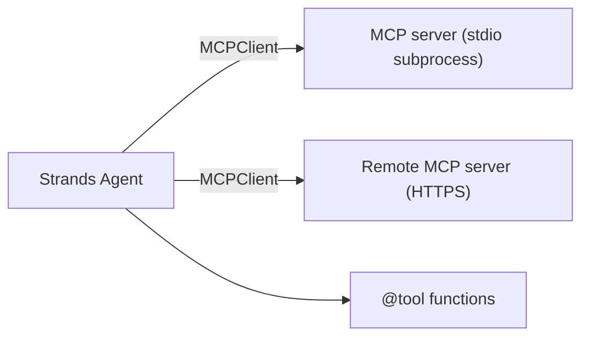

# Lesson 04 — Tools from MCP servers

## In simple words

**MCP (Model Context Protocol)** is a standard plug for tools. Someone writes an MCP server once
(GitHub, AWS docs, a database, your company API) and any agent can use it: Strands, Claude Code,
Cursor, other frameworks. Your agent **discovers the tools at runtime** instead of you hard-coding them.



Tools in one agent can come from four places, side by side in `tools=[...]`:
your `@tool` functions, SDK vended tools, MCP servers, and other agents (lesson 12).

## Files

| File | What it shows |
|------|---------------|
| [support_mcp_server.py](support_mcp_server.py) | A tiny MCP server (`MCPServer`, MCP SDK 2.x) with 3 tools, stdio or HTTP. |
| [mcp_agent.py](mcp_agent.py) | Agent using that server with a prefix, an allow-list filter and a local `@tool`. |

```bash
uv run python lessons/04_mcp_tools/mcp_agent.py
```

## Transports

| Transport | How | Use for |
|-----------|-----|---------|
| **stdio** | `MCPClient(lambda: stdio_client(StdioServerParameters(command=..., args=[...])))` — Strands starts the server as a child process. | Local tools, CLIs, dev. |
| **Streamable HTTP** | `MCPClient(url="https://.../mcp", headers={...})` | Shared/remote servers, production. |
| SSE (older) | `MCPClient(lambda: sse_client(url))` | Old servers only. |
| Config file | `MCPClient.load_servers("mcp.json")` | Many servers from one JSON file (same format as other MCP tools). |

## `MCPClient` settings

| Setting | What it does | Default | Production advice |
|---------|--------------|---------|-------------------|
| `transport_callable` / `url` | How to reach the server. | – | Remote: always HTTPS. |
| `headers`, `auth`, `auth_provider` | Credentials for remote servers (bearer token, OAuth). | none | Read tokens from a secret store at start-up, never from the prompt. |
| `prefix` | Adds `prefix_` to every tool name. | none | **Always set it** when you use more than one server, to avoid name clashes. |
| `tool_filters` | `{"allowed": [...], "rejected": [...]}` — names, regexes or functions, matched on the server's original names. | all tools | **Allow-list** only the tools this agent needs. |
| `startup_timeout` | Seconds to wait for the server to start. | 30 | Lower it so a broken server fails fast. |
| `continue_on_error` | Keep the agent running if this server fails to start. | `False` | `True` for optional servers. |
| `elicitation_callback` | Answer the server's questions to the user. | none | Wire to your UI for interactive servers. |
| `progress_callback` | Progress updates from long tool calls. | none | Show progress in a UI. |
| `tasks_config` | Long-running MCP "tasks" support. | off | For slow jobs. |
| `on_tools_changed` | Called when the server's tool list changes. | none | Log it; audit new tools. |
| `application_name/version` | Your client identity sent to the server. | none | Set it for server-side logs. |

### Lifecycle

- **Managed (recommended):** put the client in `tools=[client]`. The agent starts it on first use;
  call `agent.cleanup()` (or let the process exit) to stop it.
- **Manual:** `with client: tools = client.list_tools_sync(); agent = Agent(tools=tools)` — the server
  only lives inside the `with` block.

## The security boundary (read this twice)

- An MCP server's tools run with **its** permissions, and its **descriptions are prompts** written by
  someone else. A malicious server can describe a tool in a way that manipulates your agent.
- Only connect servers you trust, **pin versions** (`uvx pkg==1.2.3`, not `@latest`), and **filter tools**.
- A `stdio` server runs on your machine as you. Pass only the env vars it needs (`env={...}`).
- Remote servers: HTTPS + auth, and treat their results as untrusted input (lesson 16).
- For untrusted code, run servers in a sandbox (Strands Box / containers).

## Production notes

- Too many tools → worse tool selection and more tokens. Filter hard. For very many servers, the
  vended `mcp_router` tool lets the model search for tools instead of loading all of them.
- Tool calls go over a network/process boundary: they are slower and can fail. Keep `startup_timeout`
  low, and test what your agent says when a server is down (lesson 18 chaos tests).
- Put the MCP server's own logs and the agent's traces side by side when debugging (lesson 17).

## Try it

1. Remove `tool_filters` and check `agent.tool_names` — `delete_ticket` appears.
2. Run the server with `http` and change the client to `MCPClient(url="http://127.0.0.1:8765/mcp")`.
3. Add a second server with the same tool names and use two prefixes.
