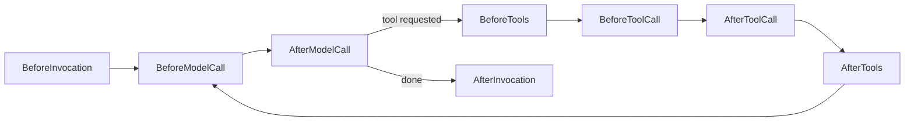

# Lesson 07 — Control your agent with hooks (and interrupts)

## In simple words

A **tool** runs only if the model decides to call it. A **hook** runs **every time** an event happens,
whatever the model thinks. Hooks are where you put rules that must not depend on the model:
audit logs, limits, approvals, input checks, retries.



## Files

| File | What it shows |
|------|---------------|
| [audit_and_limits.py](audit_and_limits.py) | `AuditLog` (JSON line per tool call), `LimitToolCounts` (per-request cap), `RetryFlakyTools` (re-run on temporary errors), and a plain function hook via `agent.add_hook`. |
| [approval_interrupt.py](approval_interrupt.py) | Human approval with `event.interrupt(...)`, and the resume loop. |

```bash
uv run python lessons/07_hooks_interrupts/approval_interrupt.py
```

## Two ways to register a hook

```python
# 1. A HookProvider class: groups related callbacks, easy to reuse and test
class AuditLog(HookProvider):
    def register_hooks(self, registry, **kwargs):
        registry.add_callback(AfterToolCallEvent, self.on_tool_done)


agent = Agent(hooks=[AuditLog()])


# 2. A plain function: the event type comes from the type hint
def announce(event: BeforeToolCallEvent) -> None: ...


agent.add_hook(announce)  # optional: order=HookOrder.SDK_FIRST, etc.
```

Callbacks may be `async def`. Several hooks can listen to the same event. `After*` events call
callbacks in **reverse** order (like cleanup code).

## Events and what you can change

| Event | Fires | Useful fields | You can set |
|-------|-------|---------------|-------------|
| `AgentInitializedEvent` | Once, when the agent is built | `agent` | – |
| `BeforeInvocationEvent` | Start of `agent(...)` | `messages`, `invocation_state` | `cancel` (stop before starting) |
| `MessageAddedEvent` | Any message added to history | `message` | – |
| `BeforeModelCallEvent` | Before each model call | `projected_input_tokens` | `cancel` |
| `AfterModelCallEvent` | After each model call | `stop_response`, `exception` | `retry = True` (call the model again) |
| `BeforeToolsEvent` | Before a batch of tool calls from one turn | `message` | `cancel`; `interrupt()` for one approval of the whole batch |
| `BeforeToolCallEvent` | Before each tool | `tool_use`, `selected_tool` | `cancel_tool = "reason"`, `selected_tool`, `tool_use`; `interrupt()` |
| `AfterToolCallEvent` | After each tool (each attempt) | `result`, `exception`, `duration` | `result` (rewrite it), `retry = True` |
| `AfterToolsEvent` | After the batch | results | – |
| `AfterInvocationEvent` | End of `agent(...)` | `result` | `resume` (continue with a new prompt) |
| Multi-agent: `Before/AfterMultiAgentInvocationEvent`, `Before/AfterNodeCallEvent` | Graph and Swarm runs | node info | – |

Every event also has `agent` and `invocation_state` (the per-call dict from lesson 03), which is how
hooks share data with tools and with each other (e.g. a `request_id`).

## Interrupts (human-in-the-loop)

| Piece | Meaning |
|-------|---------|
| `event.interrupt(name, reason=...)` | In `BeforeToolCallEvent`/`BeforeToolsEvent` hooks (or `tool_context.interrupt` in a tool). Stops the run. `name` must be unique per event; `reason` must be JSON-serializable. |
| `result.stop_reason == "interrupt"` | The run is paused. |
| `result.interrupts` | List with `id`, `name`, `reason`. |
| `agent([{"interruptResponse": {"interruptId": id, "response": answer}}])` | Resume. The same `event.interrupt(...)` call now **returns** `answer`. |
| `event.cancel_tool = "..."` | Skip the tool and tell the model why. |

Interrupt vs cancel: an **interrupt** pauses and can resume. A **cancel** (lesson 15) ends the run.

## Production notes

- **Hooks must be fast.** They run inside the loop. Push slow work (sending logs) to a queue.
- **An exception in a hook stops the run** (it propagates to your app). Catch errors in best-effort hooks
  like logging; let security hooks fail closed on purpose.
- **Log IDs and sizes, not content.** Tool inputs and results can contain personal data. The audit hook
  logs input **keys**, status and duration.
- **Reset per-request counters** in `BeforeInvocationEvent`. Limits are per request, not per process.
- **Retries:** cap them, retry only temporary errors, and make the tool idempotent. Note that
  `AfterToolCallEvent` fires once per attempt, so audit logs show every attempt.
- **Persist paused runs.** In a web app, the human answers in a later request: save the agent with a session
  manager (lesson 11) and resume with the same `session_id`.
- For typed allow/deny/approve/transform decisions, use **interventions** (lesson 09). They are built on hooks
  and handle ordering and conflicts for you.

## Try it

1. Change `LimitToolCounts({"get_weather": 3})` to `1` and read the tool results the model gets.
2. In `approval_interrupt.py`, answer `n`. What does the model tell the user?
3. Write a hook that blocks any tool call whose input contains the word `"prod"`.
