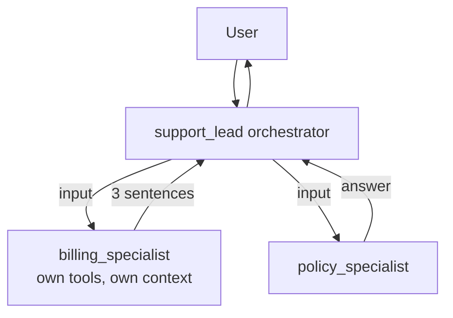

# Lesson 12 — Multi-agent pattern 1: agents as tools

## In simple words

One **orchestrator** agent talks to the user. It has **specialist** agents as tools. When it needs billing
facts it "calls" the billing specialist, gets a short answer back, and continues. Like a team lead asking
experts and then writing the reply.

Strands has three multi-agent patterns. They nest (a swarm can be a graph node, a graph can use agents-as-tools):

| Pattern | Who decides the next step | Use when |
|---------|---------------------------|----------|
| **Agents as tools** (this lesson) | the orchestrator | clear manager/specialist split, one voice to the user |
| **Graph** (lesson 13) | you, with edges | you can draw the workflow |
| **Swarm** (lesson 14) | the agents, by handing off | the path depends on what is found |

**Start with a single agent.** Add agents only when one agent's context or tool list becomes too big, or
when parts need different models, permissions or owners.

## Files

| File | What it shows |
|------|---------------|
| [agents_as_tools.py](agents_as_tools.py) | Orchestrator + two specialists, passed directly and with `as_tool()`; plus a `@tool` wrapper with its own limits. |

## Two ways to make an agent a tool

| Way | Code | You control |
|-----|------|-------------|
| Pass the agent | `tools=[billing_agent]` | Tool name = `agent.name`, description = `agent.description`, input `{"input": str}` |
| `as_tool(...)` | `billing_agent.as_tool(name=..., description=..., preserve_context=False, delegate=False)` | name/description override; memory between calls; hand the final answer straight to the user |
| `@tool` wrapper | `def research(customer_id, question): return str(Agent(...)(...))` | Typed inputs, a fresh agent per call, per-call limits, error mapping, post-processing |

| `as_tool` option | Meaning | Default |
|------------------|---------|---------|
| `preserve_context` | Keep the specialist's history across calls (it remembers earlier questions). | `False` — each call starts clean |
| `delegate` | The specialist's answer becomes the final answer; the orchestrator does not reply again. | `False` |

## Key ideas

- **The description is the routing logic.** The orchestrator picks a specialist by reading its description. No `if` statements.
- **Context isolation.** A specialist can read a huge log and return 3 lines. The orchestrator's context stays small.
- **Different models.** Strong model for the orchestrator; cheaper models for specialists (`build_model(small=True)`).
- **Silent specialists.** `callback_handler=None` on every sub-agent; only the orchestrator streams.

## Production notes

- **Bound sub-agents too**: `limits=` and a deadline in the wrapper. One runaway specialist burns the whole budget.
- **Map sub-agent failures to clear text** (`"Could not finish (limit_turns)"`) so the orchestrator can react.
- **Least privilege per specialist**: only the billing specialist gets billing tools. A prompt injection that reaches
  one specialist then has limited reach.
- **Pass identity through `invocation_state`**, not through the text the orchestrator writes (lesson 03).
- **Cost adds up**: every delegation is at least one more model call. Measure tokens per request (lesson 17).
- **Trace the tree**: each sub-agent run appears as its own span under the orchestrator's tool span (lesson 17).
- For agents in other services or languages, use **A2A** (`strands.agent.a2a_agent`, `A2AServer`) to call remote agents as tools.

## Try it

1. Give `policy_specialist` `delegate=True` and see who writes the final answer.
2. Set `preserve_context=True` and ask two related policy questions in a row.
3. Ask something neither specialist covers. Does the orchestrator still delegate?
