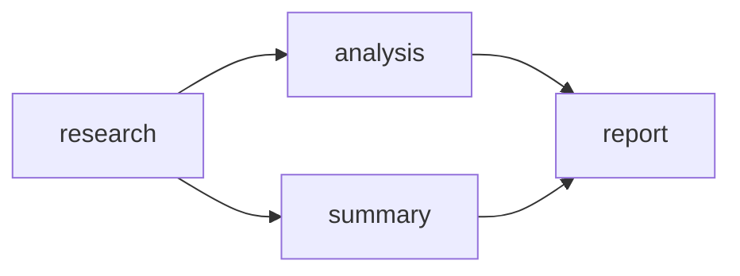
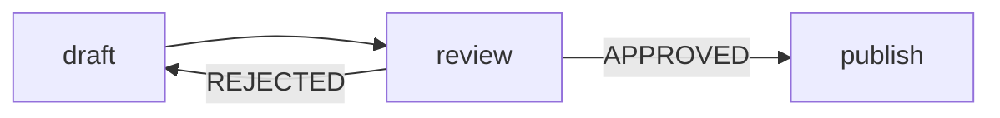

# Lesson 13 — Multi-agent pattern 2: graph workflows

## In simple words

In a graph **you** decide the order. Each node is an agent; each edge `A → B` means "B waits for A".
Nodes that don't depend on each other run **in parallel**. Use it when you can draw the process on a
whiteboard and want the same steps every time (with an audit trail).

## Files

| File | What it shows |
|------|---------------|
| [graph_workflows.py](graph_workflows.py) | Fan-out/fan-in report pipeline; a review loop with conditional edges and a cycle cap. |

## Data flow

- Entry nodes get the original task.
- Every other node gets the original task **plus** the labelled outputs of the nodes it depends on
  (`From analysis: ...`, `From summary: ...`).
- `graph(task, invocation_state={...})` shares data with every node and hook **without** showing it to models.

## `GraphBuilder` settings

| Method | What it does | Production advice |
|--------|--------------|-------------------|
| `add_node(executor, node_id)` | Add an `Agent`, a `Graph`, a `Swarm`, or any `MultiAgentBase`. | Short, stable IDs (they appear in traces). |
| `add_edge(a, b, condition=fn)` | `b` waits for `a`. `condition(state) -> bool` makes the edge optional. | Keep conditions pure and fast; read `state.results[...]`. |
| `set_entry_point(node_id)` | Where to start (otherwise: nodes with no incoming edges). | Set it when you have cycles. |
| `set_execution_timeout(s)` | Wall-clock limit for the whole graph. | Always. |
| `set_node_timeout(s)` | Limit per node. | Always. |
| `set_max_node_executions(n)` | Total node runs. | **Required for cycles.** The review loop stops with `FAILED` at 7. |
| `reset_on_revisit(bool)` | Clear a node's history when the cycle visits it again. | `False` if the node should remember past feedback. |
| `set_graph_id(id)` | Name in traces and sessions. | Always. |
| `set_session_manager(sm)` | Persist and resume a graph run (use `SnapshotSessionManager`). | Long-running or human-in-the-loop graphs. |
| `set_hook_providers([...])`, `set_plugins([...])` | Multi-agent hooks (`BeforeNodeCallEvent`, ...) and plugins. | Audit per node. |

## Reading the result

| Field | Meaning |
|-------|---------|
| `result.status` | `COMPLETED`, `FAILED`, `INTERRUPTED`... |
| `result.execution_order` | Nodes in the order they ran (`node.node_id`). |
| `result.results["report"].result` | That node's `AgentResult`. |
| `result.accumulated_usage` | Tokens for the whole graph. |
| `result.completed_nodes`, `failed_nodes`, `execution_time` | Summary numbers. |

## Production notes

- **Graphs are the most predictable pattern**: same path, same cost range, easy to test node by node.
- **A failed node fails the path**; give important nodes their own retries/limits and plan what "partial" means.
- **Cycles need caps** (`set_max_node_executions`, timeouts). Treat a `FAILED` status from a cap as a business
  outcome ("needs human review"), not a crash.
- **Parallel nodes multiply load**: fan-out of 10 nodes = 10 concurrent model calls. Watch rate limits.
- **Use the cheapest model per node** that passes its evals.
- A plain Python function can't be a node directly; wrap logic in an agent with a tool, or implement a
  custom `MultiAgentBase` node for deterministic steps.

## Try it

1. Add a `fact_check` node between `research` and `report`.
2. Make the reviewer always reject and confirm the graph stops with `FAILED`.
3. Change `reset_on_revisit(True)`: does the drafter still improve on the second try?
