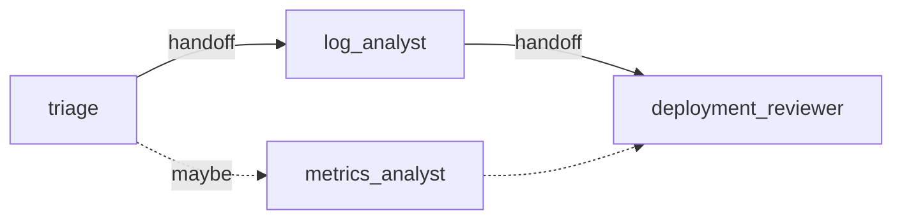

# Lesson 14 — Multi-agent pattern 3: swarms

## In simple words

A swarm is a team with **no fixed plan**. Each agent works, and when it decides someone else should
continue, it calls the built-in `handoff_to_agent` tool. Control moves to that agent, which sees what the
previous agents found. The path emerges from the work.

Good for incident debugging, open research, and any job where the next step depends on what you just found.

## Files

| File | What it shows |
|------|---------------|
| [debugging_swarm.py](debugging_swarm.py) | Incident swarm: triage → log analyst → deployment reviewer, with every safety limit set. |

## How it differs from agents-as-tools

| | Agents as tools | Swarm |
|-|-----------------|-------|
| Control | Orchestrator keeps it; specialists return answers | Full **transfer**; the previous agent is done |
| Context | Each specialist starts clean | Agents share the accumulated context |
| Handoff logic | Orchestrator's tool choice | Each agent's prompt says when to hand off; Strands adds `handoff_to_agent(agent_name, message, context)` |

## `Swarm(...)` settings

| Setting | What it does | Default | Production advice |
|---------|--------------|---------|-------------------|
| `nodes` | The agents (each needs a unique `name`). | – | 3–6 focused agents. |
| `entry_point` | Who starts. | first node | A cheap triage agent. |
| `max_handoffs` | Total handoffs. | 20 | Lower it (e.g. 10). |
| `max_iterations` | Total agent turns. | 20 | Lower it. |
| `execution_timeout` | Seconds for the whole swarm. | 900 | Match your SLA. |
| `node_timeout` | Seconds per agent turn. | 300 | Match your slowest tool. |
| `repetitive_handoff_detection_window` + `repetitive_handoff_min_unique_agents` | Stop ping-pong: in the last N handoffs there must be at least M different agents. | 0 (off) | Turn on, e.g. 6 and 2. |
| `session_manager` | Persist/resume (use `SnapshotSessionManager`). | none | For long or interrupted runs. |
| `hooks`, `plugins` | Multi-agent hooks/plugins. | none | Audit every handoff. |
| `id` | Name in traces. | `default_swarm` | Always set. |

## Reading the result

`result.status`, `result.node_history` (the path, as nodes with `.node_id`), `result.results[name].result`
(each agent's `AgentResult`), `result.accumulated_usage`, `result.execution_time`.

## Production notes

- **Always set every limit.** Nothing structural stops a swarm from bouncing; the defaults are generous.
- **Swarms are the least predictable pattern**: cost and path vary per run. Use them only when a graph can't
  express the work, and evaluate them on many cases (lesson 18).
- **Write handoff rules in each prompt** ("hand off to X when..., never hand off after giving the root cause").
  Give the final agent a clear "do not hand off" instruction.
- **Shared context can carry injected text** from tool results to the next agent. Treat it as untrusted (lesson 16).
- Log `node_history` with the request ID: it is your audit trail of who decided what.

## Try it

1. Remove "Do not hand off" from the deployment reviewer's prompt. Does the path get longer?
2. Set `max_handoffs=1` and run again: what does `result.status` say?
3. Put this swarm as a node inside the lesson 13 graph (swarm → report writer).
