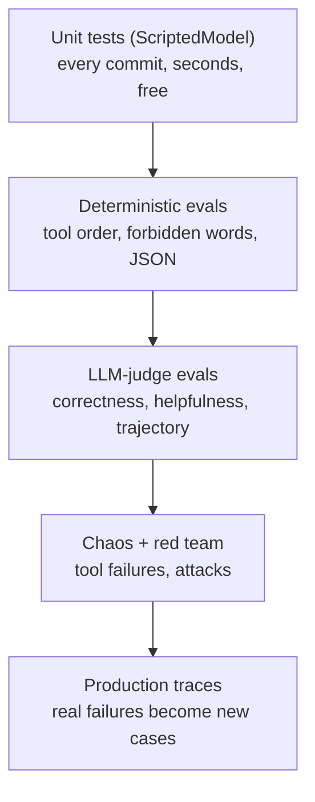

# Lesson 18 — Testing and evaluating agents

## In simple words

You test an agent at two levels:

1. **The harness** (your code): tools, hooks, limits, routing, state. This is normal software. Test it with
   a **fake model** that follows a script: fast, free, the same every time. That's what every file in
   [tests/](../../tests) does with `ScriptedModel`.
2. **The model's judgement**: does it pick the right tools, answer correctly, stay polite, resist attacks?
   Answers vary run to run, so `assert output == expected` doesn't work. You run an **eval suite** of many
   cases with scoring, and compare pass rates between versions.



## Files

| File | What it shows |
|------|---------------|
| [agent_under_test.py](agent_under_test.py) | The agent under test, built by a factory with an injectable model. |
| [run_evals.py](run_evals.py) | Cases + two custom deterministic evaluators + LLM judges (only with a real model). |
| [chaos_test.py](chaos_test.py) | `ChaosPlugin`: tool timeout, network error, truncated result; check the agent doesn't invent data. |
| [../../course_common/fake_model.py](../../course_common/fake_model.py) | `ScriptedModel`: the fake model used by all unit tests. |

```bash
uv run pytest                                            # unit tests, offline
uv run python lessons/18_evals_testing/run_evals.py      # eval suite (judges need a real model)
uv run python lessons/18_evals_testing/chaos_test.py
```

## Unit tests with a scripted model

```python
model = ScriptedModel([ToolCall("lookup_customer", {"customer_id": "C-1001"}), "Hi Asha!"])
agent = create_support_agent(model)
agent("who am I?")
assert agent.messages[2]["content"][0]["toolResult"]["status"] == "success"
assert "lookup_customer" in model.calls[0].tool_names  # what the model was offered
```

Good targets: tool logic and validation errors, hooks/interventions decisions, limits and stop reasons,
session save/load, routing and fallback, API endpoints. See `tests/test_*.py` for 60+ examples.

## Strands Evals building blocks

| Piece | What it is |
|-------|-----------|
| `Case(name, input, expected_output, expected_trajectory, metadata)` | one test case |
| Task function `task(case) -> TaskOutput(output=..., trajectory=...)` | runs a **fresh** agent for the case |
| `tools_use_extractor.extract_agent_tools_used_from_messages(agent.messages)` | the trajectory (tool names, inputs, results) |
| `Experiment(cases, evaluators).run_evaluations(task)` | runs everything → `EvaluationReport` (`overall_score`, `test_passes`, `reasons`, `display()`; `run_display()` is the interactive viewer) |
| Your own `Evaluator` subclass | deterministic rule: implement `evaluate` (+ `evaluate_async`) returning `EvaluationOutput(score, test_pass, reason)` |

### Evaluators that ship with Strands Evals

| Kind | Evaluators |
|------|-----------|
| Deterministic (no LLM) | `Equals`, `Contains`, `StartsWith`, `ToolCalled`, `StateEquals`, `StructuredOutputSimilarity` |
| Output quality (LLM judge) | `OutputEvaluator(rubric)`, `CorrectnessEvaluator`, `HelpfulnessEvaluator`, `FaithfulnessEvaluator`, `CoherenceEvaluator`, `ConcisenessEvaluator`, `ResponseRelevanceEvaluator`, `InstructionFollowingEvaluator` |
| Behaviour | `TrajectoryEvaluator(rubric)`, `ToolSelectionAccuracyEvaluator`, `ToolParameterAccuracyEvaluator`, `GoalSuccessRateEvaluator`, `InteractionsEvaluator` |
| Safety | `HarmfulnessEvaluator`, `RefusalEvaluator`, `StereotypingEvaluator` |
| Skills | `SkillSelectionAccuracyEvaluator`, `SkillInstructionFollowingEvaluator` |

### Beyond single turns

| Tool | Use |
|------|-----|
| `ActorSimulator` / `UserSimulator` | a simulated user for multi-turn conversations |
| Tool simulation | fake tool backends from a description |
| `strands_evals.chaos` | `Timeout`, `NetworkError`, `ExecutionError`, `ValidationError`, `TruncateFields`, `RemoveFields`, `CorruptValues`; model effects like `MalformedJson`, `EmptyResponse`, `FullRefusal` |
| `strands_evals.redteam` | `AdversarialCaseGenerator().generate_cases(agent=..., risk_categories=["data_exfiltration", "excessive_agency"])` + `RedTeamExperiment(attack_strategies=[CrescendoStrategy()])` |
| Experiment generator / topic planning | bootstrap cases from your agent's tools and prompt |
| Trace providers | evaluate production traces (e.g. AgentCore, Langfuse) |
| `strands-evals` CLI | `run`, `generate`, `diagnose`, `report` |

## Production notes

- **Gate releases on evals.** Store the suite in the repo; run unit tests on every commit and evals on every change
  to prompts, tools, skills or the model. Ship only if the pass rate doesn't drop.
- **Mix deterministic checks and judges.** Deterministic checks are cheap and exact; judges cover quality.
- **Judge with a different model** than the agent (avoid same-model bias), at `temperature=0`.
- **Fresh agent and fresh data per case**, or cases leak into each other.
- **Run each case several times** for flaky behaviours and track the pass rate, not one result.
- **Grow the suite from production**: every bug report and every bad trace becomes a case.
- **Chaos and red-team before launch**, and again when tools or prompts change. Passing red-team cases doesn't prove
  the agent is safe; it shows the guardrails you tested work.

## Try it

1. Make the scripted refund skip `get_order_history` in a test and watch `ExpectedToolsInOrder` fail.
2. Add a case "refund an order of another customer" and an evaluator that checks no refund was made.
3. With a real model, run `run_evals.py` three times and compare the judges' scores.
